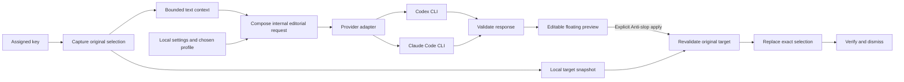

# Recommended architecture

## Local native shape

Use SwiftUI for view composition and AppKit/ApplicationServices where needed for the floating panel, application activation, accessibility and text editing. This is a recommendation based on a small Mac-only utility, not a user-specified stack. Keep the core request/state logic testable without a UI. Choose a supported deployment target after inspecting the available toolchain; record that choice.

A lightweight resident process owns a menu-bar/app-menu entry so settings is reachable without the shortcut. Avoid a backend service, embedded browser stack or account database. Preference data is local. The selected provider runtime performs inference under the user's own account and may contact its provider remotely.

The diagram is a proposed design, not an assertion that any integration already runs.

## Components and contracts

| Component | Responsibility |
|---|---|
| Shortcut service | Record/register the chosen supported key; consume it only when intended; suppress repeats; preserve recovery and local editing. |
| Capture service | Identify the original app/control, read exact selected text/range and bounded surroundings, collect available bounds. |
| Session coordinator | Own one active request, cancellation, generation and edit revisions, target snapshot and UI state. |
| Context builder | Represent unknown context explicitly; classify prose/code tentatively; apply content limits before a provider call. |
| Prompt composer | Combine versioned core, selected curated profile, guide and custom preferences through a stable precedence model. |
| Provider interface | Discover/runtime-check, sign in through official flow, report readiness, rewrite, cancel and normalize errors. |
| Response validator | Enforce schema and limits; reject malformed/extra prose or mismatched completions; never interpret model text as app commands. |
| Preview editor | Own the user's final editable draft and local undo after generation. |
| Replacement service | Revalidate and mutate only the original target; verify once; retain draft on failure or uncertainty. |
| Preferences store | Atomically persist chosen provider, shortcut, profile, optional guide and writer instructions; never store copied provider credentials. |

Keep native `TargetSnapshot` separate from the model request. It contains app process identity, an accessibility element reference where available, window/control identity, original selected range/text, nearby boundary evidence, capture time, selection bounds and available revision/fingerprint evidence. Do not send native handles, process identifiers or clipboard backups to the model. Fingerprints can detect drift; they do not prove a target is safe by themselves.

The model response has required `intent`, required `rewritten_text`, and a required nullable `note` key. Session/request identity is generated and tracked by the app, not trusted from the model. [Schemas](schemas/README.md) are proposed contracts, versioned independently from provider wire formats.

## Capture and replacement transaction

1. Before presenting an editing window, snapshot the original source and selection. Read supported accessibility attributes and check editability; applications differ.
2. Capture the exact selected text, a modest before/after excerpt where available, and minimal app/document hints. Distinguish unknown boundaries from actual start/end. Refuse secure input.
3. Build a request snapshot from the saved settings. A mid-request settings change affects the next request.
4. Start one bounded provider process/request. Results may populate the preview only if both session identity and generation revision still match and the editor has not acquired user changes.
5. For a substantive original selection, an empty or whitespace-only final editor buffer disables apply with “Enter replacement text to apply.” Recheck this condition immediately before any source mutation. On explicit valid apply, freeze the final draft and disable repeat submission. Re-resolve the stored original source, not the current frontmost field. Compare identity, editability, selection text/range and available document evidence. If a reliable comparison cannot be made, block write.
6. Apply plain text through supported accessibility mutation, or a validated clipboard/paste fallback. Do not replace the entire control value when the product only owns a selection unless exact splice and identity checks prove that operation preserves all other content.
7. Verify the observed resulting text/range using the supported mechanism. If verification is impossible, report uncertainty and keep the draft; do not silently mark success or issue a duplicate paste.
8. After confirmed success, close the panel and return focus to the source. Restore the original clipboard only if Anti-slop still owns the clipboard change; do not overwrite something the user copied meanwhile.

Clipboard fallback needs explicit concurrency handling: snapshot all preservable pasteboard types, record change count/ownership, insert plain text, wait for completion/verification, and restore only if no intervening writer appeared. A timeout is not proof that a paste failed. Document irreducible limitations and avoid claiming perfect preservation of every pasteboard type.

Apple documents accessibility attributes and attribute writes; this is capability evidence, not cross-app proof. Start with a standard editable control and a real external plain-text app. A read-only app, closed window, moved selection, changed document or unsupported control must leave the original untouched.

## Provider adapters: both required for MVP

The user specifically requires **Codex and Claude Code**, with legal professionals expected to prefer Claude Code. Either can be implemented first for the earliest vertical slice, but MVP completion requires live evidence for both. Do not silently remove Claude support if its route needs more work.

Common operations, expressed as a design contract:

- `discover()` returns runtime presence/version and supported invocation capabilities, without reading secrets.
- `checkReadiness()` reports authenticated, sign-in needed, unavailable or constrained using supported runtime status methods.
- `beginSignIn()` launches the provider-owned normal sign-in flow. The app never handles passwords/tokens.
- `rewrite(request, deadline)` returns a validated final object plus internal, sanitized timing/status metadata.
- `cancel(request)` terminates the process/request and prevents late UI updates.

Use structured process arguments and stdin. Never compose a shell string from the selected text or guide. Cap output size, enforce a deadline, consume streams without deadlock, handle process exit and cancel the process tree. Use a private, empty working directory and avoid inherited project instructions, tools, connectors, skills and hooks. The exact isolation mechanism must be verified for each installed runtime while preserving supported authentication. A read-only filesystem sandbox alone does not eliminate file reads, tool calls, hooks or network access.

For Codex, current official documentation supports saved CLI authentication and noninteractive structured output. Start by evaluating `codex exec` for this small one-request workflow. Validate its current flags, profile controls and output contract before implementation; do not paste a guessed invocation from this architecture. The App Server offers richer embedding but has version/transport-specific production qualifications, so adopting it needs a concrete reason and a documented check.

For Claude Code, evaluate the official unmodified local CLI's programmatic mode under each user's own supported sign-in. Current documentation distinguishes this route from offering a third-party Claude.ai login or collecting/intermediating credentials. Do not extract OAuth tokens or substitute an Agent SDK/API path while promising subscription access. Recheck the actual product route, terms, allowances and runtime controls in development. If the official supported route cannot satisfy the app contract, report the exact blocker for a product decision.

Both providers need a known harmless readiness/inference check before showing **Ready**. Runtime presence alone is **Installed**, not **Ready**. Account expiry, unavailable model, account limit, network failure and malformed output are separate recoverable states. Never silently switch to another provider or bill an API key inherited from the environment. Avoid printing inherited variables or credential data.

## Proposed bounded defaults

| Item | Starting limit/behavior |
|---|---|
| Selected text | 20,000 Unicode characters; reject excess without truncation |
| Nearby context | Up to 1,500 characters on each side, cut at sensible boundaries |
| Custom instructions | Up to 4,000 characters; input counter and clear error |
| Optional guide excerpt | Up to 8,000 characters plus a short local label |
| Response text | Up to 40,000 characters, plus short intent/note |
| Intent / note | 160 / 240 characters |
| Request timeout | Start at 60 seconds, visible recoverable timeout; tune with measured runs |
| Concurrency | One live rewrite, one source snapshot, one preview |
| Persistence | Settings only by default; drafts/session context stay in memory |

These limits control cost and latency and make tests concrete; tune with evidence rather than treating them as user mandates. Enforce overall provider token limits as well. Never truncate JSON or a selection to force success.

## State ownership and concurrency

`idle → capturing → generating → ready/editing → applying → success` is the normal path. Each active state can cancel; capture/generation/application can reach a recoverable error. A changed target reaches `targetChanged` with the draft intact. No mutation originates from `generating`, a provider callback, settings save or merely focusing a source app.

Use an application-generated session ID and monotonically increasing generation/edit revisions. Late completion after cancel or after a newer selection is ignored. User edit ownership begins when the draft first changes; do not merge model deltas into a user-edited buffer. Initial implementation can wait for a complete validated response rather than stream editable partial text.

## Privacy, storage and development diagnostics

Capture only on activation and only the stated context. Tell users succinctly that selected text and nearby context are sent to the selected AI connection; do not imply all processing is local. Do not log document text, guides, custom instructions, clipboard contents or credentials by default. Diagnostics can record operation type, duration, provider version, sanitized failure class and request outcome without content.

Provider runtimes may have their own transcript/retention behavior. Verify it and use supported ephemeral/no-persistence options where available; do not promise zero retention that Anti-slop cannot enforce. No cross-request conversational memory is needed. Legal-professional use increases the importance of faithful wording and clear data flow, but does not add a legal-advice engine or generic compliance dashboard.
